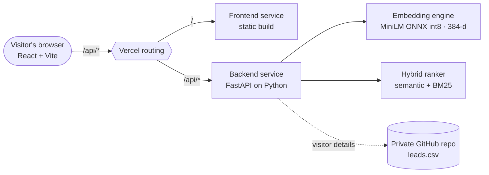
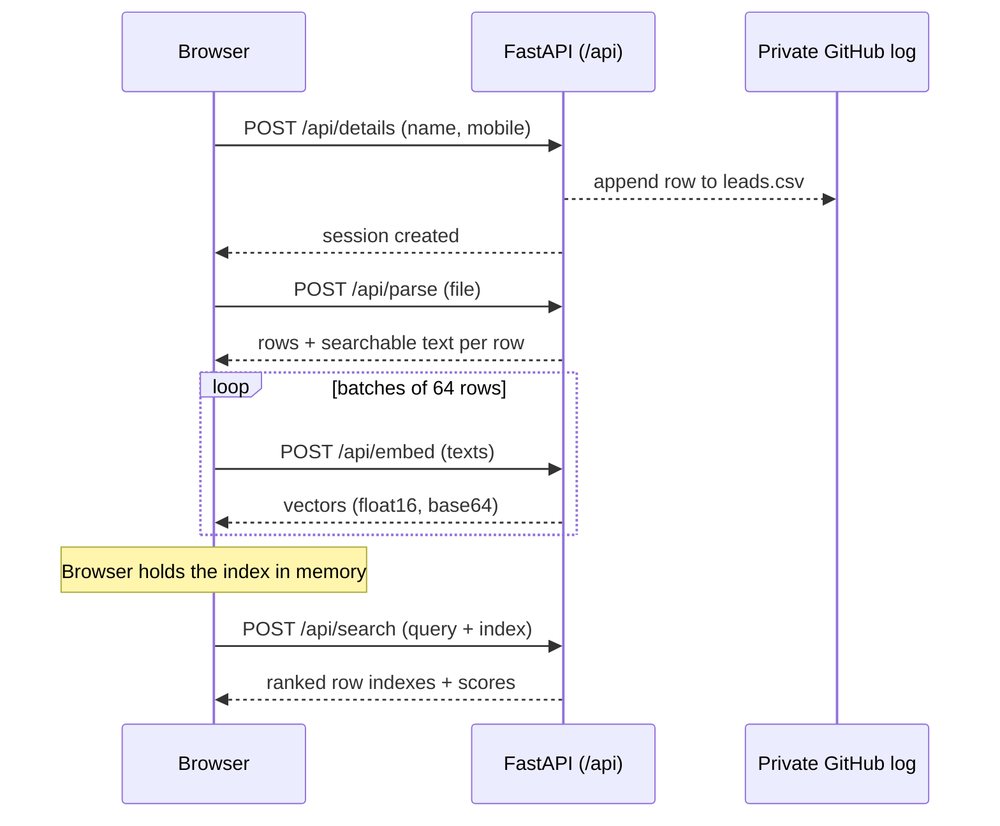

# SoldrinAI Smart Search

**Stop scrolling through spreadsheets. Ask a question, get the rows that matter.**

SoldrinAI Smart Search lets anyone upload a CSV or Excel file and search it in plain language. Searching for *"someone who works with animals"* finds the veterinarian and the dog trainer, even though neither row contains those words. Exact terms such as names, IDs and countries still match precisely, because every query blends meaning with keywords.

## Product overview

| | |
|---|---|
| **Who it's for** | Teams and individuals who live in spreadsheets: sales lists, CRM exports, catalogues, HR sheets, survey results. |
| **The problem** | Ctrl+F only finds exact words. Filters need you to know the column and the value. |
| **The experience** | Enter your details, drop in a file, ask a question, and get ranked rows with a match score. |
| **Privacy** | Uploaded files are processed in memory and never stored. Only the visitor's first name and mobile number are recorded, so the team can follow up. |
| **Cost to run** | No GPU, no vector database, no paid AI API. It runs on Vercel serverless functions. |

### User journey
1. **Your details**: first name and mobile number (validated, then logged).
2. **Upload data**: CSV or XLSX, up to 1,000 rows, 100 columns and 4 MB. The index is built with a live progress bar.
3. **Search**: type a question, or tap a suggestion generated from your own data. Results show every original column plus a match score.

## System architecture



### Request flow



### Key design decisions
- **Stateless backend.** Serverless functions keep no memory between calls, so the browser holds the index (row text and vectors) and sends it with each search. Nothing is written to disk or a database.
- **Small, CPU-only model.** `all-MiniLM-L6-v2` is a sentence-transformers model, quantized to int8 ONNX (about 23 MB) and bundled in the repo. ONNX Runtime replaces PyTorch, which would exceed Vercel's function size limit.
- **Hybrid ranking.** Final score = **65% semantic similarity** (cosine on embeddings) + **35% BM25 keyword relevance**, each min-max normalised. This keeps meaning-based recall without losing exact-match precision.
- **Batched indexing.** Embedding runs in batches of 64 rows, so each call stays well under serverless time limits and the UI shows real progress.
- **Visitor log kept out of the public repo.** Details are appended to a CSV in a separate **private** GitHub repo through the contents API, with retry on write conflicts. A logging failure never blocks the visitor.

## Repository layout

```
frontend/             Vite + React + TypeScript UI
  src/App.tsx           steps, search UI, results
  src/api.ts            typed API client + batched indexing
  src/styles.css        design system (white + blue)
backend/              FastAPI service
  index.py              routes, validation, visitor logging
  engine.py             embeddings, BM25, hybrid ranking
  files.py              CSV/XLSX parsing into rows
  model/                bundled ONNX model + tokenizer
vercel.json           Vercel Services: frontend at /, backend at /api
```

## API

| Method | Path | Purpose |
|---|---|---|
| `POST` | `/api/details` | Validate name and mobile, log the visitor, return a session id |
| `POST` | `/api/parse` | Parse an uploaded CSV/XLSX into rows and indexable text |
| `POST` | `/api/embed` | Embed up to 128 texts, returning base64 float16 vectors |
| `POST` | `/api/search` | Hybrid-rank rows for a query, returning indexes and scores |
| `GET` | `/api/health` | Liveness check |

Interactive docs are served at `/api/docs`.

## Configuration

Visitor logging is optional. Set these as Vercel environment variables:

| Variable | Description |
|---|---|
| `LOG_REPO` | `owner/repo` of the **private** log repository |
| `LOG_TOKEN` | Fine-grained GitHub token with Contents read and write on that repo only |
| `LOG_PATH` | Optional file path, default `leads.csv` |

If `LOG_REPO` or `LOG_TOKEN` is unset, logging is skipped.

## Run locally

```bash
# terminal 1: API on :8000
cd backend && python3 -m venv .venv && source .venv/bin/activate
pip install -r requirements.txt uvicorn
uvicorn index:app --port 8000

# terminal 2: UI on :5173 (proxies /api to :8000)
cd frontend && npm install && npm run dev
```

## Deploy

Push to GitHub, then in Vercel choose **Add New → Project**, import the repo and deploy. `vercel.json` configures both services. Add the environment variables above and redeploy.

## Limits and roadmap
- Limits: 1,000 rows, 100 columns, 4 MB (Vercel request-body cap), CSV and XLSX only.
- Ideas: larger files via chunked upload, saved indexes with an optional vector store, column weighting, and multilingual models.

## Contact
Questions or want something like this built for your data? [Chat on WhatsApp](https://wa.me/919833644917?text=Hi%2C%20I%20found%20SoldrinAI%20Smart%20Search%20on%20GitHub) or find me on [LinkedIn](https://www.linkedin.com/in/yaohan-fernandes/).
